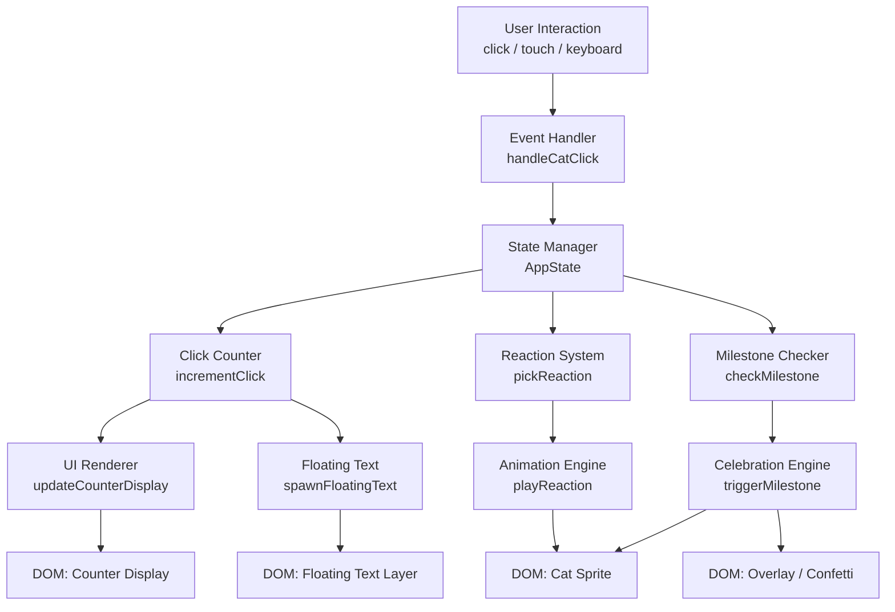

# Design Document: Cat Clicker App

## Overview

Cat Clicker App adalah aplikasi web satu halaman (SPA) yang ringan dan interaktif, dibangun dengan HTML5, Tailwind CSS (via CDN), dan Vanilla JavaScript tanpa framework tambahan. Pengguna mengklik kucing minimalis di tengah layar untuk memicu reaksi acak yang berbeda-beda, melihat penghitung klik bertambah, mendapatkan efek visual, dan mencapai milestone spesial.

Aplikasi ini sepenuhnya berjalan di sisi klien (client-side only) — tidak ada backend, tidak ada API eksternal, dan tidak ada build step. Semua state disimpan dalam memori JavaScript selama sesi browser aktif, dengan state milestone yang persisten menggunakan `sessionStorage`.

### Tujuan Desain

- **Sederhana**: Satu file HTML dengan inline CSS/JS atau file terpisah yang minimal.
- **Responsif**: Layout adaptif dari 320px hingga 1920px.
- **Performan**: Animasi 60fps menggunakan CSS transitions/keyframes, bukan JavaScript timers.
- **Aksesibel**: Mendukung keyboard navigation, screen reader, dan kontras warna WCAG AA.

---

## Architecture

Aplikasi menggunakan arsitektur **Event-Driven dengan State Machine sederhana** yang sepenuhnya ada di sisi klien.



### Prinsip Arsitektur

1. **Single Source of Truth**: Semua state ada di objek `AppState` tunggal.
2. **Separation of Concerns**: Setiap modul (ReactionSystem, AnimationEngine, dll.) hanya bertugas pada satu tanggung jawab.
3. **No Framework**: Vanilla JS murni — manipulasi DOM langsung, tanpa virtual DOM atau reactivity library.
4. **CSS-first Animation**: Animasi diimplementasikan sebagai CSS `@keyframes` dan diaktifkan dengan toggle class, bukan `setInterval` atau `requestAnimationFrame` loop manual.

---

## Components and Interfaces

### 1. AppState (State Manager)

Objek global tunggal yang menjadi sumber kebenaran untuk seluruh state aplikasi.

```javascript
const AppState = {
  totalClicks: 0,           // jumlah klik akumulatif
  currentReaction: null,    // nama reaksi yang sedang aktif (string | null)
  isAnimating: false,       // apakah Cat_Sprite sedang dalam animasi reaksi
  milestonesReached: Set,   // milestone yang sudah tercapai di sesi ini
};
```

### 2. ReactionSystem

Bertanggung jawab memilih reaksi secara acak dari pool, memastikan reaksi yang sama tidak muncul dua kali berturut-turut.

**Interface:**
```javascript
ReactionSystem = {
  pool: Reaction[],                    // daftar semua reaksi yang tersedia
  lastReaction: string | null,         // reaksi terakhir yang ditampilkan
  pick(): Reaction,                    // pilih reaksi acak (bukan lastReaction)
  interrupt(newReaction: Reaction),    // hentikan animasi saat ini, mulai yang baru
}
```

**Reaction Object:**
```javascript
{
  id: string,          // identifier unik, e.g. "surprised"
  label: string,       // label tampilan, e.g. "😲 Terkejut!"
  cssClass: string,    // CSS class untuk animasi, e.g. "reaction-surprised"
  emoji: string,       // emoji ekspresi, e.g. "😲"
  duration: number,    // durasi animasi dalam ms, e.g. 800
}
```

### 3. AnimationEngine

Mengelola siklus hidup animasi pada Cat_Sprite menggunakan CSS class toggling.

**Interface:**
```javascript
AnimationEngine = {
  play(reaction: Reaction): void,     // tambahkan CSS class, set timer untuk cleanup
  stop(): void,                       // hapus semua CSS class animasi aktif
  reset(): void,                      // kembalikan ke idle state
}
```

### 4. ClickCounter

Mengelola logika increment dan sinkronisasi tampilan counter.

**Interface:**
```javascript
ClickCounter = {
  increment(): number,              // tambah 1, return nilai baru
  getValue(): number,               // return nilai saat ini
  updateDisplay(value: number),     // perbarui DOM element counter
}
```

### 5. FloatingText

Menghasilkan elemen teks "+1" yang muncul di posisi klik dan melayang ke atas lalu menghilang.

**Interface:**
```javascript
FloatingText = {
  spawn(x: number, y: number): void,  // buat elemen, posisikan, animasikan, hapus setelah selesai
}
```

### 6. ParticleSystem

Membuat efek partikel/bintang kecil yang menyebar dari posisi klik.

**Interface:**
```javascript
ParticleSystem = {
  emit(x: number, y: number, count?: number): void,  // buat N partikel, animasikan, hapus
}
```

### 7. MilestoneChecker

Memeriksa apakah nilai klik saat ini mencapai milestone yang belum pernah dipicu.

**Interface:**
```javascript
MilestoneChecker = {
  milestones: number[],               // [10, 50, 100, 500, 1000]
  messages: Record<number, string>,   // pesan khusus per milestone
  check(clickCount: number): void,    // periksa dan trigger jika perlu
}
```

### 8. CelebrationEngine

Menampilkan animasi perayaan dan pesan milestone.

**Interface:**
```javascript
CelebrationEngine = {
  trigger(milestone: number, message: string): void,  // tampilkan overlay confetti + pesan selama >= 2 detik
  dismiss(): void,                                    // sembunyikan overlay
}
```

---

## Data Models

### Reaction Pool (minimal 5 reaksi)

| ID          | Label          | Emoji | CSS Class           | Durasi (ms) |
|-------------|----------------|-------|---------------------|-------------|
| surprised   | Terkejut       | 😲    | reaction-surprised  | 700         |
| happy       | Senang         | 😻    | reaction-happy      | 800         |
| sleepy      | Mengantuk      | 😴    | reaction-sleepy     | 1000        |
| angry       | Marah          | 😾    | reaction-angry      | 600         |
| in-love     | Jatuh Cinta    | 😍    | reaction-in-love    | 900         |
| playful     | Nakal          | 😼    | reaction-playful    | 700         |

### Milestone Configuration

| Klik | Pesan                                          |
|------|------------------------------------------------|
| 10   | "🎉 10 klik! Kucing mulai suka kamu!"          |
| 50   | "⭐ 50 klik! Kamu teman kucing sejati!"        |
| 100  | "🔥 100 klik! Kucing sudah hafal wajahmu!"     |
| 500  | "💎 500 klik! Kamu resmi jadi kucing guardian!"|
| 1000 | "👑 1000 klik! Legenda Cat Clicker sejati!"    |

### AppState Shape

```javascript
{
  totalClicks: number,          // default: 0
  currentReaction: string|null, // ID reaksi aktif, default: null
  isAnimating: boolean,         // default: false
  milestonesReached: Set<number> // default: new Set(), dipopulasi dari sessionStorage
}
```

### SessionStorage Schema

Key: `cat_clicker_milestones`
Value: JSON array of milestone numbers reached, e.g. `[10, 50]`

---

## Correctness Properties

*A property is a characteristic or behavior that should hold true across all valid executions of a system — essentially, a formal statement about what the system should do. Properties serve as the bridge between human-readable specifications and machine-verifiable correctness guarantees.*

### Property 1: Counter increment invariant

*For any* nilai Click_Counter saat ini (N ≥ 0), setelah satu klik pada Cat_Sprite, nilai Click_Counter SHALL sama dengan N + 1.

**Validates: Requirements 2.1**

### Property 2: Klik di luar Cat_Sprite tidak mengubah counter

*For any* nilai Click_Counter saat ini dan koordinat klik yang berada di luar bounding box Cat_Sprite, nilai Click_Counter SHALL tetap tidak berubah setelah klik tersebut.

**Validates: Requirements 2.5**

### Property 3: Visual feedback spawn dekat posisi klik

*For any* koordinat klik (x, y) yang valid di atas Cat_Sprite, baik elemen Floating_Text "+1" maupun elemen partikel SHALL di-spawn pada posisi yang secara geometris dekat dengan (x, y), dan keduanya SHALL dihapus dari DOM setelah animasi masing-masing selesai.

**Validates: Requirements 2.3, 4.2**

### Property 4: Reaksi tidak berulang dua kali berturut-turut

*For any* urutan klik N (N ≥ 2), untuk setiap pasangan klik berurutan (k, k+1), reaksi yang dipilih pada klik k+1 SHALL memiliki ID yang berbeda dari reaksi yang dipilih pada klik k.

**Validates: Requirements 3.6**

### Property 5: Reaksi yang dipilih selalu berasal dari Reaction_Pool

*For any* klik pada Cat_Sprite, reaksi yang dikembalikan oleh `ReactionSystem.pick()` SHALL merupakan anggota dari Reaction_Pool (diidentifikasi berdasarkan ID yang ada dalam pool).

**Validates: Requirements 3.1**

### Property 6: Siklus hidup animasi CSS class berjalan dengan benar

*For any* reaksi R dalam Reaction_Pool, ketika `AnimationEngine.play(R)` dipanggil, CSS class `R.cssClass` SHALL ditambahkan ke Cat_Sprite segera; dan setelah `R.duration` milidetik berlalu tanpa interupsi, CSS class tersebut SHALL dihapus dan Cat_Sprite kembali ke state idle.

**Validates: Requirements 3.3, 3.4**

### Property 7: Interrupt animasi berjalan dengan benar

*For any* dua reaksi berbeda R1 dan R2, jika `AnimationEngine.play(R2)` dipanggil saat animasi R1 masih berjalan, maka CSS class R1 SHALL dihapus dan CSS class R2 SHALL ditambahkan secara atomik tanpa tumpang tindih.

**Validates: Requirements 3.5**

### Property 8: Ekspresi emoji sesuai reaksi yang aktif

*For any* reaksi R yang sedang aktif pada Cat_Sprite, elemen ekspresi yang ditampilkan SHALL menunjukkan emoji yang identik dengan `R.emoji`, bukan emoji dari reaksi lain dalam pool.

**Validates: Requirements 4.5**

### Property 9: Milestone bersifat idempoten dalam satu sesi

*For any* nilai milestone M dalam {10, 50, 100, 500, 1000}, animasi perayaan dan pesan milestone SHALL dipicu tepat satu kali ketika Click_Counter pertama kali mencapai M; setiap pemanggilan `MilestoneChecker.check(M)` berikutnya dalam sesi yang sama SHALL tidak memicu perayaan lagi.

**Validates: Requirements 5.1, 5.2, 5.5**

### Property 10: Pesan milestone unik untuk setiap milestone

*For any* dua milestone berbeda M1 dan M2 dalam {10, 50, 100, 500, 1000}, pesan teks yang ditampilkan saat M1 tercapai SHALL berbeda (tidak identik) dengan pesan yang ditampilkan saat M2 tercapai.

**Validates: Requirements 5.3**

### Property 11: Layout responsif pada seluruh range viewport

*For any* lebar viewport W dalam rentang [320, 1920] piksel, Cat_Sprite SHALL terlihat (visible), tidak melampaui batas viewport (no overflow), dan dapat diklik/disentuh tanpa perlu scroll horizontal.

**Validates: Requirements 6.1**

### Property 12: Error pada modul non-kritis tidak menghentikan fungsi inti

*For any* error yang di-throw di dalam modul AnimationEngine, ParticleSystem, FloatingText, atau MilestoneChecker, fungsi inti klik (increment counter dan tampilkan nilai terbaru) SHALL tetap berjalan normal setelah error tersebut.

**Validates: Requirements 7.5**

---

## Error Handling

### JavaScript Errors

Sesuai Requirement 7.5, error yang tidak terduga dicatat ke console tanpa menghentikan fungsi inti:

```javascript
window.addEventListener('error', (event) => {
  console.error('[CatClicker Error]', event.error);
  // Jangan re-throw — biarkan aplikasi tetap berjalan
});
```

Setiap modul utama (ReactionSystem, AnimationEngine, MilestoneChecker) dibungkus dengan `try/catch` internal:

```javascript
function handleCatClick(event) {
  try {
    ClickCounter.increment();
    FloatingText.spawn(event.clientX, event.clientY);
    ParticleSystem.emit(event.clientX, event.clientY);
    const reaction = ReactionSystem.pick();
    AnimationEngine.play(reaction);
    MilestoneChecker.check(AppState.totalClicks);
  } catch (err) {
    console.error('[handleCatClick]', err);
    // counter sudah di-increment, aplikasi tetap fungsional
  }
}
```

### SessionStorage Errors

`sessionStorage` mungkin tidak tersedia (mode privat ekstrem, storage penuh). Dibungkus dengan try/catch:

```javascript
function saveMilestones(milestones) {
  try {
    sessionStorage.setItem('cat_clicker_milestones', JSON.stringify([...milestones]));
  } catch (e) {
    console.warn('[CatClicker] sessionStorage unavailable, milestones will not persist', e);
  }
}
```

### Animation Interrupt

Jika pengguna mengklik saat animasi berjalan, AnimationEngine membersihkan timer sebelumnya sebelum memulai yang baru — mencegah callback cleanup yang tumpang tindih:

```javascript
AnimationEngine = {
  _timer: null,
  stop() {
    if (this._timer) {
      clearTimeout(this._timer);
      this._timer = null;
    }
    catSprite.className = 'cat-sprite'; // reset ke base class
    AppState.isAnimating = false;
  },
  play(reaction) {
    this.stop(); // selalu bersihkan dulu
    catSprite.classList.add(reaction.cssClass);
    AppState.isAnimating = true;
    this._timer = setTimeout(() => this.reset(), reaction.duration);
  }
}
```

---

## Testing Strategy

### Unit Tests

Framework: **Vitest** (ringan, zero-config, kompatibel dengan Vanilla JS via JSDOM)

Test target dan contoh skenario:

| Modul              | Skenario                                                   |
|--------------------|------------------------------------------------------------|
| ClickCounter       | increment dari 0 → 1, increment dari 99 → 100              |
| ReactionSystem     | pick() tidak mengembalikan lastReaction; pool ≥ 5 item     |
| MilestoneChecker   | check(10) pada sesi baru memicu milestone; check(10) kedua kali tidak memicu |
| AnimationEngine    | play() menambahkan CSS class; stop() menghapus CSS class   |
| FloatingText       | spawn() membuat elemen DOM dengan teks "+1"                |

### Property-Based Tests

Framework: **fast-check** (property-based testing untuk JavaScript)

Setiap property diimplementasikan sebagai satu property test dengan minimum 100 iterasi. Contoh implementasi:

```javascript
// Feature: cat-clicker-app, Property 1: Counter increment invariant
fc.assert(
  fc.property(fc.integer({ min: 0, max: 9999 }), (initialCount) => {
    AppState.totalClicks = initialCount;
    ClickCounter.increment();
    return AppState.totalClicks === initialCount + 1;
  }),
  { numRuns: 100 }
);

// Feature: cat-clicker-app, Property 4: Reaksi tidak berulang dua kali berturut-turut
fc.assert(
  fc.property(fc.integer({ min: 2, max: 50 }), (clickCount) => {
    ReactionSystem.lastReaction = null;
    let lastId = null;
    for (let i = 0; i < clickCount; i++) {
      const r = ReactionSystem.pick();
      if (r.id === lastId) return false;
      lastId = r.id;
    }
    return true;
  }),
  { numRuns: 100 }
);

// Feature: cat-clicker-app, Property 9: Milestone bersifat idempoten dalam satu sesi
fc.assert(
  fc.property(fc.constantFrom(10, 50, 100, 500, 1000), (milestone) => {
    AppState.milestonesReached = new Set();
    let triggerCount = 0;
    const mockCelebrate = () => triggerCount++;
    MilestoneChecker.check(milestone, mockCelebrate);
    MilestoneChecker.check(milestone, mockCelebrate); // panggil dua kali
    return triggerCount === 1; // hanya sekali
  }),
  { numRuns: 100 }
);
```

**Konfigurasi**:
- Minimum 100 iterasi per property test (`numRuns: 100`)
- Setiap test diberi tag komentar: `// Feature: cat-clicker-app, Property N: <property_title>`
- 12 property tests total, masing-masing mengimplementasikan satu property dari Correctness Properties section

### Integration / Smoke Tests

- Buka `index.html` di browser, verifikasi counter dimulai dari 0
- Klik Cat_Sprite 10 kali, verifikasi milestone "10 klik" muncul
- Resize browser dari 320px ke 1920px, verifikasi layout tidak rusak
- Navigasi dengan Tab → Enter, verifikasi klik terpicu

### Accessibility Tests

- Jalankan [axe DevTools](https://www.deque.com/axe/) untuk WCAG AA compliance check
- Verifikasi manual dengan VoiceOver (macOS) atau NVDA (Windows)
- Periksa kontras warna menggunakan browser DevTools (target ≥ 4.5:1)
